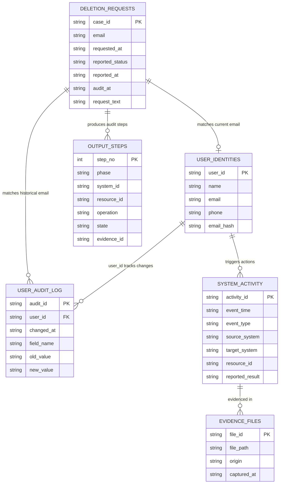

# Dataset Architecture & Deletion Audit Specification

## 1. Overview & Challenge Context

In the **Ghost Data Still Exists** challenge for HackerRank Orchestrate (October 2026), Northstar Shop experienced a critical system failure where an account reported as `COMPLETE` by the deletion workflow still existed across secondary datastores, logs, analytics, and backups.

To solve this, the audit agent must:
1. **Filter Non-Deletion Requests First:** Detect whether a request in `dataset/deletion_requests.csv` is actually authorizing deletion or requesting a different action (e.g., marketing opt-out, access request, rectification). Non-deletion requests are assigned `deletion_status = "NOT_APPLICABLE"` with `steps_json = []`.
2. **Resolve All Identity Aliases:** Connect the request email to internal `user_id`, prior email addresses, full names, phone numbers, and email SHA-256 hashes using `user_identities.csv` and `user_audit_log.csv`.
3. **Audit System State at Cutoff (`audit_at`):** Reconstruct the ground-truth state across systems using `system_activity.csv` and evidence artifacts in `dataset/evidence/` captured strictly on or before `audit_at`.
4. **Apply Deletion Policy:** Enforce the 15 rules from `dataset/deletion_rules.csv`.
5. **Generate Deterministic Remediation & Verification:** Produce `output.csv` with ordered JSON arrays of findings, safe remediation, and verification checks.

---

## 2. Dataset Structure

All participant-facing data is located in `dataset/`:

```text
dataset/
├── deletion_requests.csv          # 518 evaluation requests to audit
├── sample_deletion_requests.csv   # 32 sample requests for calibration
├── sample_output.csv              # Canonical golden answers for the 32 samples (READ-ONLY)
├── user_identities.csv            # Current identity snapshot (851 users)
├── user_audit_log.csv             # Historical identity change events (307 changes)
├── system_activity.csv            # Stream of 4,012 operational system events
├── deletion_rules.csv             # 15 policy rules governing data categories
├── evidence_files.csv             # Manifest of 95 evidence artifacts
├── output.csv                     # Submission prediction template
└── evidence/                      # Evidence datastores
    ├── databases/                 # 24 SQL snapshot dumps (read replicas, primary, failover)
    ├── documents/                 # 4 PDF registers and history reports
    ├── images/                    # 11 screenshots of admin consoles and inspectors
    ├── logs/                      # 26 server event logs, trace logs, and syslog archives
    └── records/                   # 29 JSON & text resource bundles and exports
```

---

## 3. CSV File Specifications & Field Definitions

### 3.1 `deletion_requests.csv` & `sample_deletion_requests.csv`
Defines each audit case.

| Column | Type | Description |
|---|---|---|
| `case_id` | String | Unique request ID (e.g. `case_01`, `case_33`). Primary key. |
| `email` | String | Email address supplied by the user. May be a **current or historical** email. |
| `requested_at` | ISO-8601 | Timestamp when the user submitted the request. |
| `reported_status` | Enum | Existing workflow claim: `COMPLETE`, `PARTIALLY_COMPLETE`, `NOT_STARTED`. *Treat as an unverified claim.* |
| `reported_at` | ISO-8601 | Timestamp when the existing workflow claimed `reported_status`. |
| `audit_at` | ISO-8601 | **Temporal cutoff timestamp.** Evidence captured after `audit_at` must be ignored. |
| `request_text` | String | User's natural-language message (in English, Spanish, French, Japanese, Korean, Portuguese, German, etc.). |

### 3.2 `user_identities.csv`
Snapshot of active customer profiles.

| Column | Type | Description |
|---|---|---|
| `user_id` | String | Stable internal UUID (e.g. `user_01`). |
| `name` | String | Full customer name. |
| `email` | String | Current primary email address. |
| `phone` | String | Current contact phone number. |
| `email_hash` | String | SHA-256 hash of the lowercase email. |
| `updated_at` | ISO-8601 | Timestamp when this profile snapshot was last modified. |

### 3.3 `user_audit_log.csv`
Chronological log of changes to customer identity fields.

| Column | Type | Description |
|---|---|---|
| `audit_id` | String | Unique audit event identifier (e.g. `audit_121`). Can be cited as an `evidence_id`. |
| `user_id` | String | Internal user ID linking to `user_identities.csv`. |
| `event_time` | ISO-8601 | Timestamp when the identity attribute was changed. |
| `field_name` | String | Field that was changed (`email`, `phone`, `name`). |
| `old_value` | String | Former attribute value. **Essential for mapping requests submitted using historical emails.** |
| `new_value` | String | Updated attribute value. |

### 3.4 `system_activity.csv`
Global observability stream of system operations across microservices.

| Column | Type | Description |
|---|---|---|
| `activity_id` | String | Event ID (e.g. `activity_3687`). Can be cited as an `evidence_id`. |
| `event_time` | ISO-8601 | When the event took place. |
| `event_type` | Enum | `DELETE_RECORD`, `ANONYMIZE_RECORD`, `REDACT_RECORD`, `INDEX_RECORD`, `SYNC_RECORD`, `RETAIN_RECORD`, `LINK_RESOURCE_IDENTITY`, etc. |
| `source_system` | String | Initiating service (e.g. `deletion_worker`, `account_service`, `profile_service`). |
| `target_system` | String | Target service hosting the resource (e.g. `identity_service`, `search_service`, `analytics_platform`). |
| `resource_id` | String | Identifier of the affected resource (e.g. `account_005`, `tombstone_440`, `data_flow_1770`, `backup_3870`). |
| `reported_result` | Enum | `SUCCESS`, `FAILED`, `PARTIAL`. *A claim; true resource state must be verified via evidence.* |
| `details` | String | Operational context and log explanation. |

### 3.5 `deletion_rules.csv`
The 15 governing deletion policies.

| Rule ID | Data Category | Condition | Required Action | Implementation Behavior |
|---|---|---|---|---|
| `rule_01` | `USER_PROFILE` | Always | `DELETE` | Remove record from primary and read replicas. |
| `rule_02` | `SECONDARY_IDENTIFIER` | Always | `DELETE` | Remove alternative identifiers (e.g. aliases, phones). |
| `rule_03` | `SEARCH_INDEX_ENTRY` | Always | `DELETE` | Purge search index entries. |
| `rule_04` | `CACHE_ENTRY` | Always | `DELETE` | Invalidate and purge cached data. |
| `rule_05` | `SUPPORT_MESSAGE` | Conversation contains shared context | `REDACT` | Redact customer PII; retain shared order/agent context. |
| `rule_06` | `SUPPORT_ATTACHMENT` | Belongs only to deletion subject | `DELETE` | Purge attachment files (e.g. uploaded ID docs). |
| `rule_07` | `ANALYTICS_PROFILE` | Attributable to a user | `ANONYMIZE` | Nullify or unlink direct identifiers; keep aggregate cohort. |
| `rule_08` | `PRODUCT_TELEMETRY` | Attributable to a user | `ANONYMIZE` | Strip user references from event telemetry. |
| `rule_09` | `USER_EXPORT` | Always | `DELETE` | Delete exported customer archives (`.zip`). |
| `rule_10` | `MARKETING_PROFILE` | Always | `DELETE` | Remove customer from CRM/marketing segments. |
| `rule_11` | `EMAIL_DELIVERY_LOG` | Contains user email | `REDACT` | Redact email addresses from mail delivery logs. |
| `rule_12` | `SECURITY_AUDIT_LOG` | Within retention period | `RETAIN` | **Must verify retained record exists:** `VERIFY_RECORD_PRESENT`. |
| `rule_13` | `LEGAL_HOLD_RECORD` | Legal hold is active | `RETAIN` | **Must verify retained record exists:** `VERIFY_RECORD_PRESENT`. |
| `rule_14` | `BACKUP_ARCHIVE` | Restore access can be blocked | `RETAIN` | Keep physical backup, but block restore path (`BLOCK_RESTORE`). |
| `rule_15` | `ACCOUNT_TOMBSTONE` | Internal user reference needed | `REDACT` | Preserve stable `user_id`; remove name, email, phone, and email hash. |

### 3.6 `evidence_files.csv`
Manifest mapping evidence file IDs to actual paths.

| Column | Type | Description |
|---|---|---|
| `file_id` | String | Evidence identifier (e.g. `evidence_01`, `evidence_92`). |
| `file_path` | String | Relative path inside `dataset/` (e.g. `evidence/records/service_resource_export_20260915_114455.json`). |
| `origin` | String | Source subsystem capturing the evidence (e.g. `records_assurance_snapshot_bundle`, `central_observability_export`). |
| `captured_at` | ISO-8601 | Capture timestamp. **Only files with `captured_at <= audit_at` can be cited.** |

---

## 4. Cross-File Entity Relationships & Identity Graph

The core entity graph flows from the incoming request to evidence verification:




### Identity Resolution Protocol
1. **Primary Lookup:** Match `deletion_requests.email` against `user_identities.email` (case-insensitive).
2. **Historical Lookup:** If not found in primary snapshot, match against `user_audit_log.old_value` and `user_audit_log.new_value` where `field_name = 'email'`.
3. **Assemble Complete Identity Record:**
   - Stable `user_id`
   - All email addresses (current + previous)
   - All phone numbers (current from `user_identities`, previous from `user_audit_log`)
   - Full names
   - All SHA-256 email hashes (generated for current and historical emails)
   - Linked resource IDs (e.g. `tombstone_<id>` from `LINK_RESOURCE_IDENTITY` events in `system_activity.csv`)

---

## 5. Filter 1: Non-Deletion Intent Detection (`NOT_APPLICABLE`)

Section 6.5 of `AGENTS.md` mandates that non-deletion requests must be segregated before performing any system checks:

- **Marketing Opt-Out:** Requests to stop marketing emails or promotional notifications while keeping the account active (e.g., `case_538`: *"Please remove me from marketing lists only. I still want receipts and service messages for this account."*).
- **Access Requests (GDPR Art. 15):** Requests to inspect or obtain a copy of held personal data without closing the account.
- **Rectification / Update (GDPR Art. 16):** Requests to update contact details, address, or phone number.
- **Data Export / Portability (GDPR Art. 20):** Requests asking for a data download without asking for erasure.
- **Status Inquiry:** Requests inquiring about account standing without expressing an explicit intent to delete.

### Output Contract for Non-Deletion Cases
```csv
case_id,NOT_APPLICABLE,[]
```
When `deletion_status` is `NOT_APPLICABLE`, `steps_json` must strictly be an empty array `[]`.

---

## 6. Output Contract, Allowed Operations & Step Ordering

### 6.1 Output Format
File: `output.csv` (located at root for final submission, or in `dataset/` during development).
Columns:
```text
case_id,deletion_status,steps_json
```

### 6.2 Step Object Schema
Each element in `steps_json` must contain exactly these 7 keys:
```json
{
  "step_no": 1,
  "phase": "FINDING",
  "system_id": "account_service",
  "resource_id": "account_005",
  "operation": "REPORT_REMAINING_RECORD",
  "state": "PRESENT",
  "evidence_id": "evidence_01"
}
```

### 6.3 Allowed Operations Matrix

#### Phase: `FINDING`
| Operation | State | Meaning |
|---|---|---|
| `REPORT_REMAINING_RECORD` | `PRESENT` | Record exists that policy requires to be deleted. |
| `REPORT_EXPOSED_PII` | `PRESENT` | Record exists where direct PII should have been redacted or anonymized. |
| `REPORT_ACTIVE_DATA_FLOW` | `ACTIVE` | Active integration connector/sync job can recreate or copy user data. |
| `REPORT_RESTORE_RISK` | `ACTIVE` | Backup or restore mechanism can reinstate deleted data. |

#### Phase: `REMEDIATION`
| Operation | State | Meaning |
|---|---|---|
| `DISABLE_DATA_FLOW` | `DISABLED` | Disable the active data flow / integration connector. |
| `BLOCK_RESTORE` | `BLOCKED` | Restrict backup permissions or mark user un-restorable. |
| `DELETE_RECORD` | `ABSENT` | Delete the record entirely. |
| `REDACT_RECORD` | `REDACTED` | Remove direct PII while preserving permitted reference context. |
| `ANONYMIZE_RECORD` | `ANONYMIZED` | Irreversibly unlink data from user identity. |

#### Phase: `VERIFICATION`
| Operation | State | Meaning |
|---|---|---|
| `VERIFY_RECORD_ABSENT` | `ABSENT` | Confirm record is gone (used for deleted profiles, exports, searches). |
| `VERIFY_RECORD_PRESENT` | `PRESENT` | Confirm retained record remains intact (security logs, legal holds). |
| `VERIFY_RECORD_REDACTED` | `REDACTED` | Confirm required PII has been redacted (support tickets, tombstones). |
| `VERIFY_RECORD_ANONYMIZED` | `ANONYMIZED` | Confirm record is de-identified (analytics, telemetry). |
| `VERIFY_DATA_FLOW_DISABLED` | `DISABLED` | Confirm data pipeline is stopped. |
| `VERIFY_RESTORE_BLOCKED` | `BLOCKED` | Confirm backup restore capability is neutralized. |

---

## 7. Deterministic Sorting & Ordering Rules

`output.csv` sorting and step sequencing must strictly follow these rules:

1. **Row Level:** Rows must be sorted ascending by `case_id`. Exactly 518 data rows.
2. **Phase Level:** Steps within `steps_json` must strictly appear in phase order:
   ```text
   FINDING  -->  REMEDIATION  -->  VERIFICATION
   ```
3. **Operation Level:** Within each phase, steps must follow the exact operation table sequence:
   - **`FINDING` order:** `REPORT_REMAINING_RECORD` &rarr; `REPORT_EXPOSED_PII` &rarr; `REPORT_ACTIVE_DATA_FLOW` &rarr; `REPORT_RESTORE_RISK`
   - **`REMEDIATION` order:** `DISABLE_DATA_FLOW` &rarr; `BLOCK_RESTORE` &rarr; `DELETE_RECORD` &rarr; `REDACT_RECORD` &rarr; `ANONYMIZE_RECORD`
   - **`VERIFICATION` order:** `VERIFY_RECORD_ABSENT` &rarr; `VERIFY_RECORD_PRESENT` &rarr; `VERIFY_RECORD_REDACTED` &rarr; `VERIFY_RECORD_ANONYMIZED` &rarr; `VERIFY_DATA_FLOW_DISABLED` &rarr; `VERIFY_RESTORE_BLOCKED`
4. **Tie-Breaking:** If phase and operation are identical:
   - Sort by `system_id` ascending (alphabetical).
   - Then sort by `resource_id` ascending (alphanumeric).
5. **Step Numbering:** `step_no` must start at `1` and increment consecutively (`1, 2, 3...`).
6. **Evidence Citation Rules:**
   - For `COMPLETE` cases: All `VERIFICATION` steps must cite a valid `evidence_id` (`file_id`, `activity_id`, or `audit_id`) captured on or before `audit_at`.
   - For `INCOMPLETE` cases: `FINDING` steps cite the proving `evidence_id`. Proposed `REMEDIATION` and future `VERIFICATION` steps describe prospective work and therefore must use an empty string (`"evidence_id": ""`).
