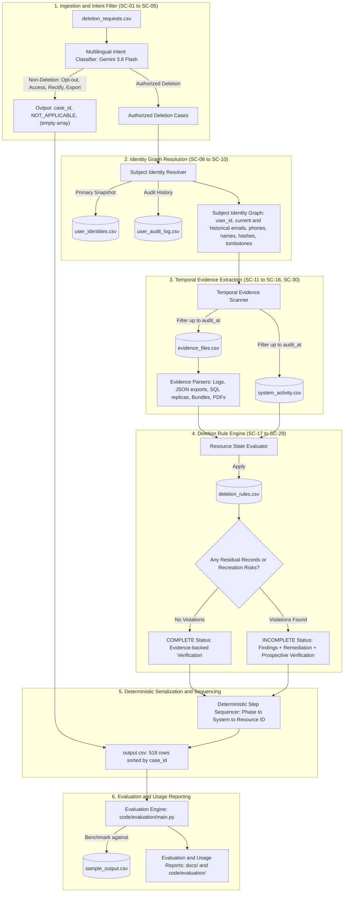

# Implementation Plan - Ghost Data Still Exists Deletion-Audit Agent

Build a deterministic, evidence-grounded AI deletion-audit agent for HackerRank Orchestrate: Ghost Data Still Exists. The agent processes 518 evaluation requests, identifies non-deletion requests as `NOT_APPLICABLE`, reconstructs current and historical identity graphs, scans temporal evidence (`captured_at <= audit_at`), enforces 15 deletion policy rules, and generates strictly ordered remediation and verification steps in `output.csv`.

---

## 1. User Review Required & Guardrails

> [!IMPORTANT]
> **API Key Safety & Environment:** `GOOGLE_API_KEY` will be read directly from the runtime environment (`os.environ["GOOGLE_API_KEY"]`). No `.env` files or secret keys will ever be committed, logged, or printed in transcripts.

> [!IMPORTANT]
> **Classification Cache & Cost Control:** A local cache (`dataset/cache/intent_cache.json`) will store Gemini 3.8 Flash classifications for `request_text` to prevent redundant API calls during iterations, keep token usage minimal, and ensure 100% deterministic re-runs.

> [!NOTE]
> **Sample Integrity Guarantee:** `dataset/sample_output.csv` will be strictly read-only for evaluation and calibration. Predictions will be output to `output.csv` (both in `./` and `dataset/`).

---

## 2. Complete Scenario Coverage Matrix

Every single scenario and edge case established in [docs/SCENARIOS.md](./SCENARIOS.md) is mapped directly to implementation components:

| Scenario ID | Scenario Name | Responsible Module | Handling Strategy |
|---|---|---|---|
| `SC-01` | Marketing Opt-Out Only (e.g. `case_538`) | `code/classifier.py` | Detects `MARKETING_OPT_OUT`. Emits `case_id,NOT_APPLICABLE,[]`. |
| `SC-02` | Data Access Request (GDPR Art. 15) | `code/classifier.py` | Detects `DATA_ACCESS`. Emits `case_id,NOT_APPLICABLE,[]`. |
| `SC-03` | Data Portability / Export (GDPR Art. 20) | `code/classifier.py` | Detects `DATA_EXPORT`. Emits `case_id,NOT_APPLICABLE,[]`. |
| `SC-04` | Profile Rectification (GDPR Art. 16) | `code/classifier.py` | Detects `RECTIFICATION`. Emits `case_id,NOT_APPLICABLE,[]`. |
| `SC-05` | Multilingual Deletion Authorization | `code/classifier.py` | Prompt tuned for ES, FR, JA, KO, PT, DE to recognize deletion verbs. |
| `SC-06` | Current Primary Email Match | `code/identity.py` | Direct join on `user_identities.csv:email`. |
| `SC-07` | Historical Email Alias Shift (`case_10`) | `code/identity.py` | Fallback search in `user_audit_log.csv:old_value`. |
| `SC-08` | Multiple Identity Modifications | `code/identity.py` | Aggregates all historical names, phones, and emails for `user_id`. |
| `SC-09` | Decoy Identity Disambiguation (`case_28`) | `code/identity.py` & `evidence_scanner.py` | Strict `user_id` & exact alias token matching; discards decoy records. |
| `SC-10` | Email Casing & Hash Normalization | `code/identity.py` | Normalizes to lowercase and generates SHA-256 hashes for all aliases. |
| `SC-11` | False Positive (`COMPLETE` Claim &rarr; Incomplete) | `code/evidence_scanner.py` | Ignores claimed status; extracts real state from replica/readback evidence. |
| `SC-12` | False Negative (`PARTIAL` / `NOT_STARTED` &rarr; Complete) | `code/evidence_scanner.py` | Verifies clean state in evidence; outputs `COMPLETE` with citations. |
| `SC-13` | True Negative (Workflow incomplete, records exist) | `code/auditor.py` | Captures residual records; emits `FINDING` + `REMEDIATION` + `VERIFICATION`. |
| `SC-14` | True Positive (Workflow complete, verified clean) | `code/auditor.py` | Emits `COMPLETE` with evidence-backed `VERIFICATION` steps only. |
| `SC-15` | Valid Evidence Captured `<= audit_at` | `code/evidence_scanner.py` | Files with `captured_at <= audit_at` are indexed and cited. |
| `SC-16` | Discard Evidence Captured `> audit_at` | `code/evidence_scanner.py` | Strictly filters out files/events where timestamp `> audit_at`. |
| `SC-17` | Account Tombstone Exposed PII (`rule_15`, `case_32`) | `code/auditor.py` | Identifies PII in tombstone; emits `REPORT_EXPOSED_PII` &rarr; `REDACT_RECORD`. |
| `SC-18` | Compliant Tombstone (`rule_15`, `case_31`) | `code/auditor.py` | Confirms PII is null; emits `VERIFY_RECORD_REDACTED`. |
| `SC-19` | Retained Security Audit Log (`rule_12`) | `code/auditor.py` | Confirms audit log within retention period; emits `VERIFY_RECORD_PRESENT`. |
| `SC-20` | Active Data Flow Recreating Data (`case_15`) | `code/auditor.py` | Connector `enabled = true`; emits `REPORT_ACTIVE_DATA_FLOW` &rarr; `DISABLE_DATA_FLOW`. |
| `SC-21` | Inactive / Disabled Data Flow (`case_26`) | `code/auditor.py` | Connector `enabled = false`; emits `VERIFY_DATA_FLOW_DISABLED`. |
| `SC-22` | Active Backup Restore Risk (`case_09`) | `code/auditor.py` | `restore_allowed = true`; emits `REPORT_RESTORE_RISK` &rarr; `BLOCK_RESTORE`. |
| `SC-23` | Blocked Backup Restore Path (`case_27`) | `code/auditor.py` | `restore_allowed = false`; emits `VERIFY_RESTORE_BLOCKED`. |
| `SC-24` | Exposed Support Ticket PII (`rule_05`, `case_19`) | `code/auditor.py` | Ticket has customer email/name; emits `REPORT_EXPOSED_PII` &rarr; `REDACT_RECORD`. |
| `SC-25` | Redacted Support Ticket (`rule_05`, `case_26`) | `code/auditor.py` | Ticket PII is null, context remains; emits `VERIFY_RECORD_REDACTED`. |
| `SC-26` | Exposed Analytics Profile (`rule_07`, `case_22`) | `code/auditor.py` | Analytics has email/phone; emits `REPORT_EXPOSED_PII` &rarr; `ANONYMIZE_RECORD`. |
| `SC-27` | Anonymized Analytics Profile (`rule_07`, `case_03`) | `code/auditor.py` | Analytics has cohort only; emits `VERIFY_RECORD_ANONYMIZED`. |
| `SC-28` | Search Index Residual Record (`rule_03`, `case_06`) | `code/auditor.py` | Index query hit; emits `REPORT_REMAINING_RECORD` &rarr; `DELETE_RECORD`. |
| `SC-29` | Residual Export Archive (`rule_09`, `case_08`) | `code/auditor.py` | Export zip present; emits `REPORT_REMAINING_RECORD` &rarr; `DELETE_RECORD`. |
| `SC-30` | Replica Replication Drift (`rule_01`, `case_05`) | `code/evidence_scanner.py` | Compares primary vs failover/read replicas to identify residual copies. |

---

## 3. Architecture & Component Workflow



---

## 4. Component Implementation Specifications

### Component 1: Multilingual Intent Classification (`code/classifier.py`)
- **Handles Scenarios:** `SC-01`, `SC-02`, `SC-03`, `SC-04`, `SC-05`.
- **Model:** `gemini-3.8-flash` with `temperature=0.0`.
- **API Key Management:** Read directly via `os.environ.get("GOOGLE_API_KEY")`. Never written to disk, logged, or printed.
- **Classification Schema:**
  ```json
  {
    "is_deletion": true,
    "intent": "DELETION",
    "language": "es",
    "rationale": "User requests complete removal of account and data."
  }
  ```
- **Recognized Non-Deletion Intents:**
  - `MARKETING_OPT_OUT` (e.g. `case_538`): Wants receipts/service messages, unsubscribe marketing only.
  - `DATA_ACCESS`: Wants copy of records under GDPR Art. 15 / CCPA without account closure.
  - `DATA_EXPORT`: Wants downloadable transaction archive under GDPR Art. 20 without deletion.
  - `RECTIFICATION`: Wants phone/address/name updated under GDPR Art. 16.
  - `STATUS_INQUIRY`: Questions whether account is deleted without submitting a deletion directive.
- **Local Caching:** Results cached in `dataset/cache/intent_cache.json`. When cache entry exists, API call is bypassed.

---

### Component 2: Subject Identity Resolution (`code/identity.py`)
- **Handles Scenarios:** `SC-06`, `SC-07`, `SC-08`, `SC-09`, `SC-10`.
- **Resolution Algorithm:**
  1. **Primary Match (`SC-06`):** Search `user_identities.csv` for `email.strip().lower()`. If found, retrieve `user_id`, `name`, `phone`, `email_hash`.
  2. **Historical Alias Fallback (`SC-07`):** If not found, search `user_audit_log.csv` where `field_name == 'email'` and `old_value.strip().lower() == email.strip().lower()` (or `new_value`). Retrieve `user_id`.
  3. **Multi-Attribute Evolution Aggregation (`SC-08`):** For the resolved `user_id`:
     - Query all `user_audit_log.csv` records for this `user_id`.
     - Collect all historical emails (`old_value` and `new_value`).
     - Collect all historical phones (`old_value` and `new_value`).
     - Collect all historical names.
  4. **Email Hash Normalization (`SC-10`):** Compute lowercase SHA-256 hashes for all collected email variants.
  5. **Tombstone Mapping:** Find linked `tombstone_<id>` in `system_activity.csv` (`LINK_RESOURCE_IDENTITY` or `identity_service` events).
  6. **Decoy Disambiguation (`SC-09`):** Filter out records matching partial strings but associated with a different `user_id`.

---

### Component 3: Evidence & Activity Scanner (`code/evidence_scanner.py`)
- **Handles Scenarios:** `SC-11`, `SC-12`, `SC-15`, `SC-16`, `SC-30`.
- **Cutoff Gatekeeper (`SC-15`, `SC-16`):**
  - Only load evidence files where `captured_at <= audit_at`.
  - Only load system activity events where `event_time <= audit_at`.
  - Strictly ignore later evidence.
- **Evidence Parsers:**
  - `LogParser`: Scans `evidence/logs/resource_lookup_trace_*.log` for lines matching subject identifiers or resources (`account_...`, `search_...`, `support_...`, `data_flow_...`, `backup_...`, `analytics_...`, `audit_record_...`). Extracts `http_status` (404 vs 200), `result` (`hit` vs empty), `enabled` (`true` vs `false`), `restore_allowed` (`true` vs `false`).
  - `JsonResourceParser`: Scans `evidence/records/service_resource_export_*.json` for service lookups across all 8 microservices.
  - `SqlDatabaseParser`: Executes or parses SQLite dumps in `evidence/databases/*.sql`. Specifically detects replica drift (`SC-30`) by comparing `customer_profiles_failover_replica` vs `customer_profiles_primary`.
  - `SnapshotBundleParser`: Scans `evidence/records/customer_data_snapshot_bundle_*.json` for tombstone states in `deleted_customer_references`.

---

### Component 4: Deletion Rules & Step Sequencer (`code/auditor.py`)
- **Handles Scenarios:** `SC-13`, `SC-14`, `SC-17` to `SC-29`.
- **Policy Evaluation Logic:**
  - **Account Profile (`rule_01`, `SC-30`):** If present in any primary or replica store &rarr; `REPORT_REMAINING_RECORD` &rarr; `DELETE_RECORD` &rarr; `VERIFY_RECORD_ABSENT`.
  - **Search Index (`rule_03`, `SC-28`):** If hit in index query &rarr; `REPORT_REMAINING_RECORD` &rarr; `DELETE_RECORD` &rarr; `VERIFY_RECORD_ABSENT`.
  - **Export Archive (`rule_09`, `SC-29`):** If object zip exists &rarr; `REPORT_REMAINING_RECORD` &rarr; `DELETE_RECORD` &rarr; `VERIFY_RECORD_ABSENT`.
  - **Support Attachment (`rule_06`):** If uploaded ID document exists &rarr; `REPORT_REMAINING_RECORD` &rarr; `DELETE_RECORD` &rarr; `VERIFY_RECORD_ABSENT`.
  - **Support Ticket (`rule_05`, `SC-24`, `SC-25`):** If customer email/name present &rarr; `REPORT_EXPOSED_PII` &rarr; `REDACT_RECORD` &rarr; `VERIFY_RECORD_REDACTED`. If already redacted &rarr; `VERIFY_RECORD_REDACTED` (for complete case).
  - **Analytics Profile (`rule_07`, `SC-26`, `SC-27`):** If email/phone present &rarr; `REPORT_EXPOSED_PII` &rarr; `ANONYMIZE_RECORD` &rarr; `VERIFY_RECORD_ANONYMIZED`. If cohort-only &rarr; `VERIFY_RECORD_ANONYMIZED` (for complete case).
  - **Account Tombstone (`rule_15`, `SC-17`, `SC-18`):** If tombstone contains name/email/phone/hash &rarr; `REPORT_EXPOSED_PII` &rarr; `REDACT_RECORD` &rarr; `VERIFY_RECORD_REDACTED`. If only `user_id` present &rarr; `VERIFY_RECORD_REDACTED`.
  - **Integration Data Flow (`SC-20`, `SC-21`):** If connector `enabled == true` &rarr; `REPORT_ACTIVE_DATA_FLOW` &rarr; `DISABLE_DATA_FLOW` &rarr; `VERIFY_DATA_FLOW_DISABLED`. If `enabled == false` &rarr; `VERIFY_DATA_FLOW_DISABLED` (for complete case).
  - **Backup Archive (`rule_14`, `SC-22`, `SC-23`):** If archive has `restore_allowed == true` &rarr; `REPORT_RESTORE_RISK` &rarr; `BLOCK_RESTORE` &rarr; `VERIFY_RESTORE_BLOCKED`. If `restore_allowed == false` &rarr; `VERIFY_RESTORE_BLOCKED` (for complete case).
  - **Security Audit Log (`rule_12`, `SC-19`):** If within retention window &rarr; `VERIFY_RECORD_PRESENT`.
- **Verdict Construction:**
  - If any Finding is detected: `deletion_status = "INCOMPLETE"`. Emits all `FINDING` steps &rarr; all `REMEDIATION` steps &rarr; all future `VERIFICATION` steps. Proposed remediation and post-remediation verification steps strictly set `"evidence_id": ""`.
  - If no Findings detected: `deletion_status = "COMPLETE"`. Emits only `VERIFICATION` steps proving the compliant state, each citing its valid proving `evidence_id`.
- **Strict Step Sequencing:**
  1. Phase order: `FINDING` &rarr; `REMEDIATION` &rarr; `VERIFICATION`.
  2. Within-phase operation sequence:
     - Findings: `REPORT_REMAINING_RECORD` &rarr; `REPORT_EXPOSED_PII` &rarr; `REPORT_ACTIVE_DATA_FLOW` &rarr; `REPORT_RESTORE_RISK`
     - Remediation: `DISABLE_DATA_FLOW` &rarr; `BLOCK_RESTORE` &rarr; `DELETE_RECORD` &rarr; `REDACT_RECORD` &rarr; `ANONYMIZE_RECORD`
     - Verification: `VERIFY_RECORD_ABSENT` &rarr; `VERIFY_RECORD_PRESENT` &rarr; `VERIFY_RECORD_REDACTED` &rarr; `VERIFY_RECORD_ANONYMIZED` &rarr; `VERIFY_DATA_FLOW_DISABLED` &rarr; `VERIFY_RESTORE_BLOCKED`
  3. Tie-breaking: `system_id` ASC, then `resource_id` ASC.
  4. Step numbering: `step_no` strictly 1, 2, 3... consecutively.

---

### Component 5: Main Orchestration Runner (`code/main.py`)
- Loads `dataset/deletion_requests.csv` (or `--samples` flag for sample set).
- Iterates sequentially through cases.
- Emits formatted CSV rows with headers `case_id,deletion_status,steps_json`.
- Writes output to `output.csv` (at root) and mirrors to `dataset/output.csv`.
- Ensures exactly 518 data rows sorted by `case_id`.

---

### Component 6: Benchmark & Evaluation Suite (`code/evaluation/main.py`)
- Reads predictions and benchmarks directly against `dataset/sample_output.csv`.
- Evaluates:
  - Case-level status accuracy (`COMPLETE`, `INCOMPLETE`, `NOT_APPLICABLE`).
  - Step-level set accuracy (precision, recall, F1).
  - Field-level accuracy across all 7 step keys.
  - Sequence accuracy (exact 1-to-1 array order).
- Automatically writes:
  - `code/evaluation/evaluation_report.md`
  - `code/evaluation/usage_report.md`

---

## 5. Verification & Testing Plan

### Automated Tests
1. **Scenario-by-Scenario Unit Tests (`tests/test_scenarios.py`):**
   - Test `SC-01` to `SC-05`: Intent classifier correctly flags `case_538` as `NOT_APPLICABLE` and multi-lingual requests as `DELETION`.
   - Test `SC-06` to `SC-10`: Identity resolver maps historical email in `case_10` to `user_10` and handles decoy disambiguation for `case_28`.
   - Test `SC-11` to `SC-14`: Workflow false positives (`case_05`) and false negatives (`case_02`) correctly audited against evidence.
   - Test `SC-15` & `SC-16`: Temporal cutoff tests verify that evidence captured after `audit_at` is never used.
   - Test `SC-17` to `SC-30`: Policy evaluator correctly handles tombstone PII (`case_32`), backup restore risks (`case_09`), active data flows (`case_15`), search entries (`case_06`), and support tickets (`case_19`).
2. **Calibration Benchmark on Sample Set:**
   Run `code/main.py --samples` and evaluate against `dataset/sample_output.csv`:
   - Target: 100% case status accuracy on the 32 sample requests.
   - Target: 100% sequence accuracy on sample steps.
3. **Full Dataset Audit Execution:**
   Run `code/main.py`:
   - Verify output has exactly 518 data rows sorted by `case_id`.
   - Verify every JSON array is valid and step numbers are consecutive.
4. **Evaluation Report Generation:**
   Run `code/evaluation/main.py` and confirm `evaluation_report.md` and `usage_report.md` are produced.

### Manual Verification
- Verify `output.csv` format matches `case_id,deletion_status,steps_json`.
- Verify `log.txt` conforms to `AGENTS.md` per-turn requirements.
